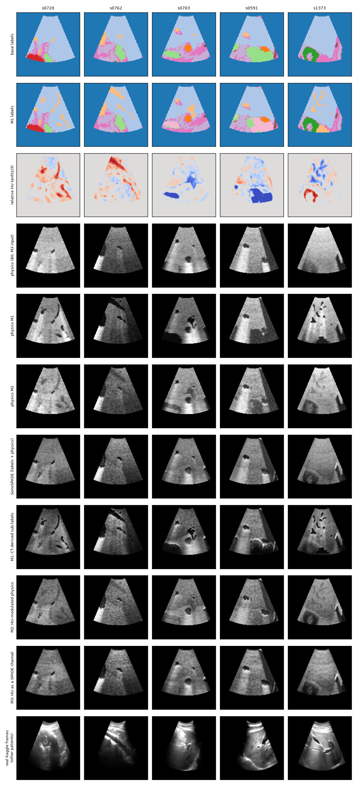

# Results: three ways to use CT intensity in SonoSPADE

## Summary

**Short answer: in this setup, none of the three ways of using CT intensity beats SonoSPADE as
released (B0) on any metric that compares against real ultrasound of other people. M1 changes what the images
show the most; M3's generator learns to ignore the HU channel.** All trained rows are mean ± SD
over 3 GAN seeds, scored on 330 frames from 11 CTs never used in training.

| | organ W1 ↓ | heterogeneity gap ↓ | TSTR Dice ↑ |
|---|---|---|---|
| B0 SonoSPADE | **0.089 ± 0.008** | **0.051 ± 0.002** | 0.109 ± 0.002 |
| M1 CT sub-labels | 0.125 ± 0.007 | 0.059 ± 0.010 | 0.107 ± 0.008 |
| M2 HU-modulated physics | 0.099 ± 0.003 | 0.057 ± 0.001 | 0.106 ± 0.008 |
| M3 HU as a SPADE channel | 0.102 ± 0.022 | 0.053 ± 0.005 | 0.113 ± 0.000 |
| physics render alone (base labels) | 0.056 | 0.066 | 0.101 |

*Figure: five held-out poses (one per CT; s1373 is arterial phase), GAN seed 0. Rows: labels, the
relative-HU channel, the three physics renders, the four trained variants, and real Kaggle frames
from other people.*

### What the CT adds, variant by variant

* **M1 (CT sub-labels)** puts the patient's own intrahepatic vessels, bowel gas and kidney cysts in
  the image, and the generator keeps them (figure, M1 row). It is also the worst on organ W1
  (0.125 vs 0.089), driven by the liver (0.090 vs 0.047). The vessel pixels alone do not explain
  that: the M1 *physics* render has the same liver W1 as the base render (0.023 vs 0.022). The M1
  generator moves liver intensities further from real. A likely contributor, not tested here:
  M1's frozen segmenter is weaker (held-out sim Dice 0.577 vs 0.656 for B0), because it must also
  find the new gas and vessel regions, and that segmenter's consistency loss is one of the
  generator's main constraints.
* **M2 (HU-modulated physics)** shows faint density variation in the physics render (figure, physics
  M2), which the GAN mostly smooths away. It is between B0 and M1 on every metric. Its liver
  heterogeneity is lower than B0's (0.101 vs 0.113), the opposite of the intent.
* **M3 (HU as a SPADE channel)** barely uses the channel. Zeroing it changes the output by 0.3% of
  full scale on average (HU sensitivity 0.0030 ± 0.0003), and its frames look like B0's. Nothing in
  the unpaired objective rewards using HU: the discriminator and the segmenter only judge tissue
  classes, and no real frame comes with that patient's CT.

### Points that hold for every variant

* **No variant closes the liver heterogeneity gap.** Real liver regions have a smoothed-intensity SD
  of 0.176; every row, physics or translated, sits at 0.10-0.11. The real frames show bright vessel
  walls and fascia lines (figure, last row) that no variant renders. That is one visible candidate
  for the gap, not a measured cause.
* **The raw physics renders beat every trained generator on organ W1** (0.054-0.056 vs
  0.089-0.125) and tie them on TSTR. The generators do help heterogeneity (kidney SD 0.05 vs 0.03
  for physics; real 0.093). This is a property of this repository's setup (128-px sector-warped
  frames, 1,500 iterations, held-out CTs, 60 labeled real frames). It is not a comparison with the
  published SonoSPADE evaluation, which used a different protocol.
* **TSTR has little power here.** All rows are at 0.10-0.11 and within seed SD of each other. Spleen
  never appears in the held-out poses (0 of 330 frames), so its TSTR Dice is 0 everywhere, and
  kidney Dice is below 0.05 for every row. The one suggestive difference is vessel Dice from
  physics with M1 labels (0.115, per seed 0.059 / 0.141 / 0.146) against base labels (0.075; 0.071
  / 0.044 / 0.109). The seeds overlap, and the difference does not survive translation (M1 0.036 vs
  B0 0.037).

### What this does and does not show

Every metric here compares against ultrasound of *other* people. Such metrics reward population
realism, so they cannot reward a variant for drawing *this* patient's vessels or gas correctly; at
best they do not penalize it. M1 shows that the CT adds real, patient-specific structure. Whether
that structure is *right* needs ultrasound of the same patient. Among public data, only TRUSTED
(kidney) provides that ([PAIRED_DATA.md](PAIRED_DATA.md)).

## Same-patient test (TRUSTED) and M4

TRUSTED (Ndzimbong et al., Sci. Data 2025) pairs 3D transabdominal kidney ultrasound with the CT of
the same patient. The CTs are labeled with TotalSegmentator (as a new patient's CT would be); each
US volume is registered to its CT rigidly (7 landmarks, then trimmed ICP on the kidney masks; mean
kidney Dice 0.86, min 0.61; median renal-pelvis landmark residual 4.1 mm). Native planes are cut
along the probe's own sweep, with the virtual fan apex on the real array apex, so synthetic and real
beams coincide: 413 planes from 59 kidneys of 39 patients. Each plane is rendered without
randomization and passed through every trained model.

Metric: Pearson r between the smoothed (1.5 px) synthetic frame and the smoothed real US of the same
plane, over the eroded kidney and over the kidney with a 4 px band, after removing a quadratic trend
in depth inside the region; per-kidney mean, then mean over kidneys; Wilcoxon signed-rank over
kidneys against B0.

| | r kidney ↑ | r kidney+band ↑ | vs B0 (kidney) |
|---|---|---|---|
| CT slice itself | −0.326 | −0.333 | |
| B0 | 0.228 ± 0.017 | 0.260 ± 0.016 | |
| M1 CT sub-labels | 0.200 ± 0.019 | 0.239 ± 0.010 | −0.018, p < 0.001, 17/59 up |
| M2 HU physics | **0.248 ± 0.006** | **0.280 ± 0.009** | **+0.021, p = 0.009, 37/59 up** |
| M3 HU channel | 0.230 ± 0.006 | 0.268 ± 0.008 | +0.004, p = 0.27 |
| M3, channel zeroed | 0.233 ± 0.005 | 0.271 ± 0.007 | +0.007, p = 0.014 |
| M4c learned echogenicity, no HU | 0.325 ± 0.005 | 0.343 ± 0.004 | +0.087, p < 0.001, 53/59 up |
| M4 learned HU-to-echo | 0.325 ± 0.005 | 0.343 ± 0.004 | +0.084, p < 0.001, 53/59 up |

* **The CT slice correlates negatively with the US inside the kidney** (−0.33): sinus fat is dark in
  CT and bright in US, enhanced parenchyma the reverse.
* **M2 is the only hand-set variant that helps on the same patient**, although it lost to B0 on
  organ W1 against other people's scans. Its render already beats the base render (+0.028, 55/59
  kidneys) and the generator keeps the gain.
* **M1 loses** although its render equals the base render in these planes (+0.000): the loss comes
  from the M1 generator, as in the unpaired comparison.
* **M3 ignores the HU here too**: zeroing the channel changes r by −0.004 (slightly in favor of zero).
* **M4** (learned per-tissue offset a and 9-knot curve g over relative HU, multiplying the label's
  backscatter; trained through the split differentiable renderer, a differentiable resize and
  sector warp and the frozen B0 generator; TRUSTED's own 5 patient folds x 3 GAN seeds) raises r to
  0.325 on held-out patients, and its render alone reaches 0.310. **M4c, which learns the offsets
  only, matches it exactly** (M4 − M4c: +0.000, p = 0.30), and even on the training planes the
  curves raise the fit by at most 0.0015. The learned offsets make kidney darker and fat and other
  soft tissue brighter; the HU curves are shallow next to them.
* The signs hold on the 30 better-registered kidneys (Dice ≥ 0.88): M2 +0.028 (p = 0.05), M1 −0.023,
  M3 +0.003, M4 +0.098.

### Which part of M2 helps (ablation)

Every plane re-rendered from the stored scan-grid slices (full M2 reproduces the stored frames
exactly) with one part of M2 at a time, translated with the M2 generators (3 seeds):

| | render vs base render | translated vs B0 |
|---|---|---|
| M2 impedance only | −0.001 | +0.008 (p = 0.40) |
| M2 backscatter only | +0.031 | +0.022 (p = 0.006) |
| M2 backscatter as its per-tissue mean | +0.014 | +0.016 (p = 0.033) |
| full M2 | +0.028 | +0.021 (p = 0.009) |

All of M2's gain is its backscatter rule; impedance adds nothing. About half of the render gain
(most of the translated gain) is the tissue-level darkening, the rest the within-tissue pattern.

### M4 robustness

With penalties 100x weaker, M4 − M4c = +0.002 (p = 0.18); started at M2's backscatter rule (weak
penalties), the curves move away from that rule and M4 − M4c = +0.002 (p = 0.17). The penalties do
not explain why the shared HU curve adds nothing.

### M5: a mapping fitted to each patient

M5 starts from the population M4 (the fold that held the patient out) and re-fits the per-tissue
curves on some of the patient's own planes (100 Adam steps, pull toward the starting values 1e-2,
smoothness 1e-2), then renders the patient's other planes. M5c fits the offsets only. Splits:
the 7 planes of each kidney halved by sweep angle, each half predicted from the other (59 kidneys);
each kidney predicted from the patient's other kidney (40 kidneys of 20 patients).

| | fit planes, mean gain | held-out r kidney | vs M5c | vs shared M4 |
|---|---|---|---|---|
| M5, sweep halves | +0.030 | 0.326 ± 0.005 | +0.000 (p = 0.83) | +0.001 (p = 0.40) |
| M5c, sweep halves | +0.023 | 0.326 ± 0.005 | | |
| M5, other kidney | +0.019 | 0.329 ± 0.005 | +0.000 (p = 0.75) | +0.000 (p = 0.66) |
| M5c, other kidney | +0.015 | 0.330 ± 0.005 | | |

Each patient fit improves the planes it is fitted to, but nothing carries over to the patient's
other planes, with or without HU. A curve fitted to one patient sees one contrast phase, so the
phase does not explain why the HU curve adds nothing; registration residual (~4 mm) and the
128-px resolution remain as explanations.

### Full resolution and deformable registration

Registration: a smooth displacement field (8 mm control grid, diffusion penalty 2000, chosen on 3
kidneys so it does not fold) added to the rigid transform, fitted so the signed distances to the CT
and US kidney surfaces match; the landmarks are not used. Mean kidney Dice 0.86 -> 0.97 (min 0.94);
median per-kidney landmark residual 6.6 -> 5.5 mm (lower in most kidneys); one field folds slightly
(314L, min Jacobian -0.05), and excluding it changes no conclusion.

Full resolution: real US sampled at 0.3 mm (its voxel size) in each native plane; renders on 320
scan lines (lateral PSF scaled to keep the beam width in mm), scan-converted to the same grid;
1 mm smoothing; regions in mm. Only renders exist at this resolution, so M4/M5 and their controls
are retrained on the full-resolution renders. The 128 px pipeline is also rerun with the deformable
registration (B0-M3 re-scored, M4/M4c retrained).

| r kidney (detrended) | 128 px rigid | 128 px deformable | 0.3 mm rigid | 0.3 mm deformable |
|---|---|---|---|---|
| CT slice itself | -0.326 | -0.378 | -0.296 | -0.332 |
| render, base labels | 0.063 | 0.065 | 0.038 | 0.040 |
| render, M2 | 0.119 | 0.124 | 0.087 | 0.095 |
| B0 | 0.228 | 0.250 | | |
| M2 | 0.248 | 0.272 | | |
| M4c | 0.325 | 0.354 | 0.249 | 0.264 |
| M4 | 0.325 | 0.355 | 0.249 | 0.264 |
| M5c (sweep halves) | 0.326 | 0.358 | 0.252 | 0.268 |
| M5 (sweep halves) | 0.326 | 0.358 | 0.252 | 0.269 |
| M6c spatial network, labels only | | **0.432** | | |
| M6 spatial network, CT | | **0.432** | | |
| **M4 - M4c** | +0.0002 (p = 0.30) | **+0.0006 (p < 0.001)** | +0.0002 (p = 0.17) | +0.0004 (p = 0.36) |
| **M5 - M5c** | +0.0001 (p = 0.83) | +0.0001 (p = 0.96) | 0.0000 (p = 0.63) | +0.0005 (p = 0.11) |
| **M6 - M6c** | | -0.0004 (p = 0.65) | | |

Deformable registration raises every translated row at 128 px (B0 +0.028, p = 0.029) and keeps every
comparison (M2 +0.020 vs B0, p = 0.017; M1 -0.031; M3 +0.001). With it, the shared HU curve's gain
becomes detectable (+0.0006 at 128 px, 41/59 kidneys; +0.0004 over kidney + band at 0.3 mm,
p = 0.004) but stays below 0.001, against +0.094 for M4c's re-tuned echogenicity over B0. Per patient
the curves add nothing at either resolution with either registration. All rows and both smoothing
scales: [TRUSTED_HIRES.md](TRUSTED_HIRES.md).

### M6: a spatial CT-to-echogenicity network

M6 replaces M4's per-tissue curve by a small CNN on the render's scan grid (3 dilated 5 x 9
convolutions of 32 channels, receptive field about 1-2 cm, 114k parameters) whose input is the
one-hot labels, z/4 and the HU scaled from [-200, 300]; its output is added to the per-tissue
offsets and clipped as in M4. M6c is the same network on the labels alone. Both are trained like
M4 (patient-level 5 folds x 3 GAN seeds, same loss through the frozen B0 generator; 600 steps of 8
planes), at 128 px with the deformable registration (`scripts/train_m6.py`, `scripts/run_m6.sh`).

- The spatial network gives the largest gain of every row: 0.432 in the kidney, +0.068 over M4
  (p < 0.001), +0.075 with the band.
- The labels-only control reaches the same value: M6 - M6c = -0.0004 (p = 0.65) in the kidney,
  -0.0019 (p = 0.42) with the band; M6c is +0.068 over M4c (p < 0.001).
- M6 does use the CT: flattening z and HU to their per-tissue median in each plane changes its log
  factor by 0.11 on average (spread of the factor 1.22). The use raises agreement neither on held-out
  patients nor on the training planes (training r 0.466 with the CT, 0.468 without;
  `scripts/m6_hu_use.py`).

So the large gain comes from spatial context that the label map already carries (where the sinus and
cortex lie inside the kidney outline, distances to interfaces), not from CT intensity within a
tissue.

Full table with raw (undetrended) correlations and the whole-fan r: [TRUSTED_TABLE.md](TRUSTED_TABLE.md).
TRUSTED data and every image derived from it stay out of this repository (Data Usage Agreement).

## Protocol

**Content.** TotalSegmentator CTs. Training: the 8 CTs SonoSpade trained on (s0011, s0058, s0344,
s0358, s0461, s0477, s0511, s0513), 110 poses each, plus 2 view-augmented copies per pose
(2,640 frames). Evaluation: 11 held-out CTs, never used in training, 30 poses each (330 frames).
2 of the 11 are arterial-phase (s0727, s1373).

**One pose sweep for all variants.** For each pose, the same mild domain-randomization draw and
speckle seed render three physics images (base labels; M1 labels; HU-modulated). Base labels, M1
labels and the relative-HU channel are stored next to them. Everything is resized to 128x128 and
warped to the Kaggle sector geometry with one set of coordinates. The variants therefore differ only
in how they use the CT.

**Training.** SonoSPADE's objective and loss weights, unchanged (configs/sonospade.yaml from
SonoSpade v0.2.0): OASIS discriminator, PatchNCE, frozen-S_US consistency, temporal consistency,
LabelMix, R1, EMA. 1,500 iterations, batch 4, the 404-frame real Kaggle pool, GAN seeds 0, 1, 2.
Each variant's S_US (grouped scheme, 3,000 iterations) is trained on its own physics images and
labels. B0 and M3 share one, since their inputs are identical.

**Evaluation.** All rows are scored on the 330 held-out frames against the 60 labeled real Kaggle
frames, using the 13-class base labels for every variant:
* organ W1: per-organ intensity Wasserstein-1 to real, mean over liver, gallbladder, vessel,
  kidney and spleen;
* heterogeneity gap: |SD of the 2-px-smoothed intensity inside the eroded organ, fake minus real|,
  over liver, kidney and spleen. Speckle averages out at that scale; vessels and gas do not;
* TSTR Dice: a segmenter trained on the translated frames, tested on the real frames, mean of 3
  segmenter seeds;
* edge IoU against the variant's own physics input; label-swap locality; HU sensitivity (M3).

**What this cannot show.** The real frames come from other people (Kaggle volunteers), so no metric
here says whether a variant reproduces *this patient's* texture. See [PAIRED_DATA.md](PAIRED_DATA.md).

## Full tables

Generated by `scripts/summarize.py` from `outputs/compare.json` (also in
[RESULTS_TABLE.md](RESULTS_TABLE.md)). SD is across GAN seeds (population SD, n = 3).

Held-out CT content: 330 frames from 11 CTs (s0519, s0522, s0591, s0649, s0703, s0720, s0727, s0762, s0777, s1086, s1373); real reference: 60 labeled Kaggle ussimandsegm frames.
Trained rows: mean ± SD over GAN seeds (n per row in the last column). TSTR per row is itself a mean over 3 segmenter seeds.

| Row | organ W1 ↓ | heterogeneity gap ↓ | TSTR Dice ↑ | edge IoU ↑ | locality ↑ | HU sensitivity | n |
|---|---|---|---|---|---|---|---|
| physics render, base labels | 0.056 | 0.0657 | 0.101 | 1.000 | n/a | n/a | 1 |
| physics render, M1 labels | 0.054 | 0.0622 | 0.112 | 1.000 | n/a | n/a | 1 |
| physics render, HU-modulated | 0.055 | 0.0688 | 0.103 | 1.000 | n/a | n/a | 1 |
| B0 SonoSPADE (labels + physics) | 0.089 ± 0.008 | 0.0514 ± 0.0020 | 0.109 ± 0.002 | 0.552 ± 0.006 | 25.7 ± 0.6 | 0.0000 ± 0.0000 | 3 |
| M1 CT sub-labels | 0.125 ± 0.007 | 0.0589 ± 0.0097 | 0.107 ± 0.008 | 0.554 ± 0.016 | 25.4 ± 2.6 | 0.0000 ± 0.0000 | 3 |
| M2 HU-modulated physics | 0.099 ± 0.003 | 0.0574 ± 0.0005 | 0.106 ± 0.008 | 0.526 ± 0.002 | 29.0 ± 3.3 | 0.0000 ± 0.0000 | 3 |
| M3 HU as a SPADE channel | 0.102 ± 0.022 | 0.0530 ± 0.0053 | 0.113 ± 0.000 | 0.541 ± 0.022 | 22.6 ± 3.1 | 0.0030 ± 0.0003 | 3 |

Per-organ intensity W1 to real (lower is better):

| Row | liver | gallbladder | vessel | kidney | spleen |
|---|---|---|---|---|---|
| physics render, base labels | 0.022 | 0.041 | 0.098 | 0.064 | n/a |
| physics render, M1 labels | 0.023 | 0.040 | 0.099 | 0.054 | n/a |
| physics render, HU-modulated | 0.025 | 0.040 | 0.091 | 0.066 | n/a |
| B0 SonoSPADE (labels + physics) | 0.047 ± 0.005 | 0.059 ± 0.007 | 0.116 ± 0.012 | 0.133 ± 0.023 | n/a |
| M1 CT sub-labels | 0.090 ± 0.006 | 0.088 ± 0.009 | 0.168 ± 0.011 | 0.152 ± 0.006 | n/a |
| M2 HU-modulated physics | 0.069 ± 0.001 | 0.047 ± 0.022 | 0.133 ± 0.006 | 0.149 ± 0.027 | n/a |
| M3 HU as a SPADE channel | 0.057 ± 0.017 | 0.075 ± 0.014 | 0.134 ± 0.030 | 0.142 ± 0.029 | n/a |

Low-frequency heterogeneity (SD of 2-px-smoothed intensity inside the organ; real in brackets):

| Row | liver | kidney | spleen |
|---|---|---|---|
| physics render, base labels | 0.1084 [0.1758] | 0.0291 [0.0932] | n/a |
| physics render, M1 labels | 0.1104 [0.1758] | 0.0343 [0.0932] | n/a |
| physics render, HU-modulated | 0.1033 [0.1758] | 0.0280 [0.0932] | n/a |
| B0 SonoSPADE (labels + physics) | 0.1127 ± 0.0014 [0.1758] | 0.0534 ± 0.0028 [0.0932] | n/a |
| M1 CT sub-labels | 0.1011 ± 0.0116 [0.1758] | 0.0500 ± 0.0080 [0.0932] | n/a |
| M2 HU-modulated physics | 0.1010 ± 0.0017 [0.1758] | 0.0531 ± 0.0013 [0.0932] | n/a |
| M3 HU as a SPADE channel | 0.1139 ± 0.0087 [0.1758] | 0.0490 ± 0.0020 [0.0932] | n/a |

TSTR per-class Dice on the real frames:

| Row | liver | gallbladder | vessel | kidney | spleen |
|---|---|---|---|---|---|
| physics render, base labels | 0.395 | 0.036 | 0.075 | 0.000 | 0.000 |
| physics render, M1 labels | 0.427 | 0.018 | 0.115 | 0.000 | 0.000 |
| physics render, HU-modulated | 0.428 | 0.020 | 0.065 | 0.000 | 0.000 |
| B0 SonoSPADE (labels + physics) | 0.416 ± 0.013 | 0.060 ± 0.017 | 0.037 ± 0.010 | 0.033 ± 0.002 | 0.000 ± 0.000 |
| M1 CT sub-labels | 0.401 ± 0.041 | 0.073 ± 0.011 | 0.036 ± 0.010 | 0.025 ± 0.001 | 0.000 ± 0.000 |
| M2 HU-modulated physics | 0.402 ± 0.036 | 0.056 ± 0.004 | 0.045 ± 0.011 | 0.027 ± 0.004 | 0.000 ± 0.000 |
| M3 HU as a SPADE channel | 0.412 ± 0.014 | 0.069 ± 0.006 | 0.042 ± 0.004 | 0.039 ± 0.009 | 0.000 ± 0.000 |
